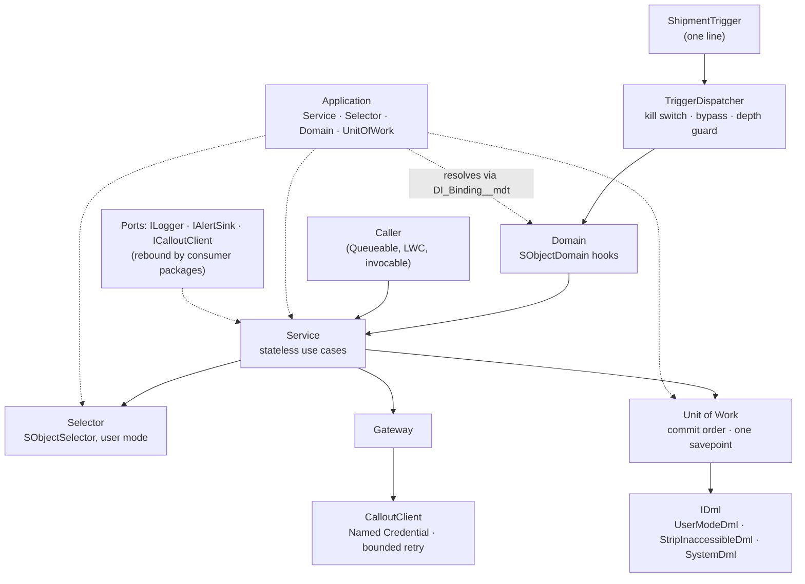

# apex-core-lib

[](https://github.com/csquaredaz/apex-core-lib/actions/workflows/ci.yml)


## The problem

Most Salesforce orgs grow their Apex one trigger at a time. Logic sits in trigger bodies, SOQL and DML are scattered through services, field-level security is checked by hand (or not at all), and every integration rolls its own retry loop. The result is code that breaks at 200 records, can't be unit-tested without the database, and fails security review. The usual fix, vendoring the full FFLIB libraries, solves the structure but brings a large API surface, and those libraries alone don't give a team secure-by-default data access or a disciplined callout client. `apex-core-lib` is a small, readable foundation, distributed as an unlocked package with no namespace: a DI container, FFLIB-style layers, a trigger framework, user-mode data access and a callout client with bounded retry. Its design is informed by production experience at scale.

## Architecture



Every collaborator is resolved by interface or SObject type through `Application`. Code defaults bind the ports to safe built-in adapters, an active `DI_Binding__mdt` row overrides a default, and `setMock` overrides both in tests.

| Layer    | Classes                                                                                                                 | Pattern                              |
| -------- | ----------------------------------------------------------------------------------------------------------------------- | ------------------------------------ |
| DI       | `Application`, `ServiceFactory`, `SelectorFactory`, `DomainFactory`, `UnitOfWorkFactory`, `BindingRegistry`             | Service Locator, Abstract Factory    |
| Domain   | `IDomain`, `SObjectDomain`, `IDomainConstructor`                                                                        | Table Module, Template Method        |
| Triggers | `TriggerDispatcher`, `TriggerContext`, `Trigger_Setting__mdt`                                                           | Dispatcher, Adapter                  |
| Data     | `ISelector`, `SObjectSelector`, `IUnitOfWork`, `UnitOfWork`, `IDml`, `UserModeDml`, `StripInaccessibleDml`, `SystemDml` | Data Mapper, Unit of Work, Decorator |
| Callouts | `ICalloutClient`, `CalloutClient`, `CalloutRequest`, `CalloutResponse`, `RetryPolicy`                                   | Builder, Retry, Strategy             |
| Ports    | `ILogger`, `IAlertSink`, `DebugLogger`, `NoOpAlertSink`                                                                 | Ports and Adapters, Null Object      |
| Test kit | `Mocks`, `FakeId`, `RecordingLogger`                                                                                    | Test Double                          |

## Quick start

```bash
npm ci
npm run org:setup
npm run org:test
```

`org:setup` creates a scratch org, deploys the library and the [`example/`](example) shipments app, and assigns their permission sets. It needs the Salesforce CLI and a Dev Hub set as the default (`sf config set target-dev-hub=<alias>`).

### Install the package in your own org

Each `v*` tag builds an unlocked package version (no namespace, ADR 0001) and attaches its install command to the [GitHub release](../../releases). The current released version is `1.0.0-1`:

```bash
sf package install --package 04tak000000u0zpAAA --target-org <alias> --wait 20 --no-prompt
```

It installs in any org, including production. Versions not yet promoted install only in scratch orgs and sandboxes. In a consumer project, declare the dependency in `sfdx-project.json` as `"dependencies": [{ "package": "apex-core-lib@1.0.0-1" }]`, with that alias mapped to the `04t` Id. The test kit (`Mocks`, `FakeId`, `RecordingLogger`) is usable from consumer tests once the package is installed.

**Upgrading to 1.1.0:** 1.1.0 adds `dmlUpsert` to `IDml` and `registerUpsert` to `IUnitOfWork` ([CHANGELOG](CHANGELOG.md), ADR 0009). If you implement either interface by hand, add the method to your class before you upgrade. Stub API mocks are unaffected.

## Usage

The [`example/`](example) directory is a complete, unpackaged app: shipments for orders, booked with a fictional carrier. Bind its classes with metadata rows rather than code:

| `DI_Binding__mdt`  | `Kind__c` | `Interface__c`      | `Implementation__c`           |
| ------------------ | --------- | ------------------- | ----------------------------- |
| Shipments_Selector | Selector  | `Shipment__c`       | `ShipmentsSelector`           |
| Shipments_Domain   | Domain    | `Shipment__c`       | `ShipmentsDomain.Constructor` |
| Shipments_Service  | Service   | `IShipmentsService` | `ShipmentsService`            |
| Carrier_Gateway    | Service   | `ICarrierGateway`   | `CarrierGateway`              |

The trigger holds no logic, and the domain holds the behaviour (shortened; the full class also defaults `Status__c` and requests booking after insert):

```apex
trigger ShipmentTrigger on Shipment__c(before insert, after insert /* … every event */) {
  TriggerDispatcher.run();
}

public with sharing class ShipmentsDomain extends SObjectDomain {
  public ShipmentsDomain(List<Shipment__c> records) {
    super(records);
  }
  public override SObjectType getSObjectType() {
    return Shipment__c.SObjectType;
  }
  public override void onValidate() {
    for (Shipment__c shipment : (List<Shipment__c>) records) {
      if (shipment.Weight_Kg__c == null || shipment.Weight_Kg__c <= 0) {
        shipment.addError(Shipment__c.Weight_Kg__c, 'Weight must be greater than zero.');
      }
    }
  }
  public class Constructor implements IDomainConstructor {
    public IDomain construct(List<SObject> records) {
      return new ShipmentsDomain((List<Shipment__c>) records);
    }
  }
}
```

After insert, the domain asks the service to book the new shipments, and the service enqueues `CarrierBookingJob` (triggers can't call out). The job's service method queries through a selector, calls out through a gateway, and writes through a Unit of Work, all in user mode (from `ShipmentsService.bookShipments`):

```apex
IShipmentsSelector selector = (IShipmentsSelector) Application.Selector.newInstance(Shipment__c.SObjectType);
List<Shipment__c> pending = selector.selectPendingById(shipmentIds);

Map<Id, String> referencesById;
try {
  referencesById = ((ICarrierGateway) Application.Service.newInstance(ICarrierGateway.class)).book(pending);
} catch (CalloutClientException e) {
  ((ILogger) Application.Service.newInstance(ILogger.class))
    .error('Carrier booking failed for ' + pending.size() + ' shipment(s); they stay Pending.', e);
  return;
}

IUnitOfWork unitOfWork = Application.UnitOfWork.newInstance(new List<SObjectType>{ Shipment__c.SObjectType });
for (Shipment__c shipment : pending) {
  String reference = referencesById.get(shipment.Id);
  if (reference != null) {
    unitOfWork.registerDirty(
      new Shipment__c(Id = shipment.Id, Status__c = ShipmentsDomain.STATUS_BOOKED, Carrier_Reference__c = reference)
    );
  }
}
unitOfWork.commitWork();
```

The gateway owns the wire format and sends one idempotent request for the whole batch through the callout client (from `CarrierGateway.book`):

```apex
CalloutRequest request = CalloutRequest.post('Carrier', '/v1/bookings')
  .withJsonBody(payload)
  .withIdempotencyKey(idempotencyKey(shipments));
CalloutResponse response = ((ICalloutClient) Application.Service.newInstance(ICalloutClient.class)).send(request);
```

For idempotent writes, such as re-delivered events, register upserts on an external Id. Each type's upserts run after its inserts, so `registerRelationship` also works on an upserted parent (`Log__c` and `Log_Key__c` stand in for your own object and key):

```apex
IUnitOfWork unitOfWork = Application.UnitOfWork.newInstance(new List<SObjectType>{ Log__c.SObjectType });
unitOfWork.registerUpsert(rows, Log__c.Log_Key__c); // one statement; matched rows are updated, not duplicated
unitOfWork.commitWork();
```

To switch the shipment trigger off in production without a deploy, set `Trigger_Setting.Shipment.Is_Active__c` to false. To swap the logger for `apex-platform-logging`, add one `DI_Binding__mdt` row for `ILogger`.

## Design decisions

| Decision              | Choice                                                                                                    | Rejected alternative                                          | ADR                                                     |
| --------------------- | --------------------------------------------------------------------------------------------------------- | ------------------------------------------------------------- | ------------------------------------------------------- |
| Distribution          | Unlocked package, no namespace                                                                            | Source copy via a pinned script; a namespaced package         | [0001](docs/adr/0001-apex-core-lib-distribution.md)     |
| FFLIB                 | A lean in-repo core with FFLIB-compatible names, plus a small Stub API helper                             | Vendoring `fflib-apex-common` and `fflib-apex-mocks`          | [0002](docs/adr/0002-lean-fflib-core.md)                |
| Coverage badge        | shields.io endpoint badge from a `badges` branch                                                          | Codecov, a SaaS that breaks the free-only rule                | [0003](docs/adr/0003-coverage-badge.md)                 |
| Dependency resolution | Service Locator with `DI_Binding__mdt` overrides                                                          | A code-only registry per consumer; constructor injection only | [0004](docs/adr/0004-di-bindings-in-custom-metadata.md) |
| Data security         | User mode by default; `StripInaccessibleDml` and `SystemDml` are explicit opt-outs                        | System mode plus manual describe checks                       | [0005](docs/adr/0005-user-mode-by-default.md)           |
| Triggers              | A domain constructor class per domain, a metadata kill switch, and a depth guard of 2 with logged skips   | `initialise(records)`; a run-once flag                        | [0006](docs/adr/0006-trigger-framework.md)              |
| Callouts              | Up to 2 immediate retries on idempotent requests; throw when retries run out; no synchronous retry on 429 | Async backoff in the client; retrying 429                     | [0007](docs/adr/0007-callout-retry-policy.md)           |
| CI budget             | A merge to `main` reuses the PR's scratch-org result when the tree is identical                           | A second scratch org per merge; scheduled `main` runs         | [0008](docs/adr/0008-reuse-pr-scratch-org-results.md)   |
| Upsert (1.1.0)        | Add `dmlUpsert` / `registerUpsert` to the existing interfaces as a minor version                          | Extension interfaces; 2.0.0; a consumer-owned store           | [0009](docs/adr/0009-upsert-in-a-minor-version.md)      |

Deliberately omitted, each with its reason recorded where a reader would look for it:

- A circuit breaker, which needs state shared across transactions (ADR 0007).
- Finalizer recovery on the example's Queueable, which is the subject of `apex-event-ingestion` (`CarrierBookingJob`).
- Any paid service or SaaS in CI (ADR 0003).

## Testing

| Layer                       | What it proves                                                                                                                                                                                                          | Run it                                    |
| --------------------------- | ----------------------------------------------------------------------------------------------------------------------------------------------------------------------------------------------------------------------- | ----------------------------------------- |
| Apex unit (Stub API mocks)  | Factories, dispatcher, domain hooks, retry rules and services in isolation, with fake trigger contexts and scripted HTTP mocks                                                                                          | `npm run org:test`                        |
| Apex integration (real DML) | 200 shipments saved as a least-privilege user → trigger → domain → Queueable → carrier → commit, with 0 SOQL and at most 2 DML statements; a user without access is denied; a carrier outage leaves shipments `Pending` | `npm run org:test`                        |
| Static analysis             | Zero High or Critical Code Analyzer findings; Prettier; gitleaks (pre-commit hook and CI)                                                                                                                               | `npm run analyze`, `npm run format:check` |

195 Apex tests and 100% coverage. Coverage is a floor (90%) in CI, not the goal. Tests assert behaviour, including bulk (200-record) cases and negative paths. CI runs static checks on every PR. On ready PRs it also creates a fresh scratch org through JWT auth, deploys, runs every Apex test, gates on all passing and on coverage, and deletes the org. A merge to `main` does the same, unless its tree is identical to a PR head that already passed, in which case it reuses that result (ADR 0008).

## Built with Claude Code

- **Standards:** this repo's [`CLAUDE.md`](CLAUDE.md) and the [`apex-standards`](https://github.com/csquaredaz/claude-code-salesforce-skills) plugin (`apex-fflib-layers`, `apex-security`, `apex-testing`, `apex-code-review`, `sf-repo-scaffold`) set the rules: clean-room code, bulk-safe layers, user mode by default, behavioural tests, and an ADR for every significant decision.
- **One concrete example:** in [PR #4](https://github.com/csquaredaz/apex-core-lib/pull/4), Claude Code recommended giving domains an `initialise(records)` method. The human reviewer chose FFLIB's constructor-class pattern instead, so records stay `final`. Claude built that, and [ADR 0006](docs/adr/0006-trigger-framework.md) records both options. In the same PR, Code Analyzer flagged the planned base class `Domain` as High (`TypeShadowsBuiltInNamespace`: it shadows `System.Domain`), and it was renamed `SObjectDomain` before review. In [PR #5](https://github.com/csquaredaz/apex-core-lib/pull/5), the planned `CalloutException` would have shadowed `System.CalloutException`, so it became `CalloutClientException`.
- **How AI work is reviewed:** every design trade-off is put to a human as 2–3 options with a recommendation before code is written. Every AI-assisted commit carries a `Co-Authored-By: Claude` trailer and goes through a PR with CI, and the human merges every PR.

## License

MIT
